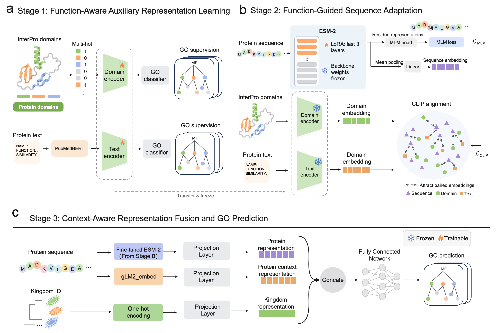

# MicroFAlign
MicroFAlign: Function-Aware Multimodal Alignment of Protein Language Models for Improving Microbial Protein Function Prediction
## Introduction
MicroFAlign trains GO-supervised domain and text encoders, aligns ESM2 sequences with their frozen representations, and predicts GO functions from aligned sequence, gLM2 and kingdom features. 



Overview of MicroFAlign. (a) Domain and text encoders are
    independently pretrained with GO supervision. (b) The frozen auxiliary
    encoders guide ESM-2 adaptation through contrastive learning and MLM; LoRA
    updates are applied to the final three Transformer layers. (c) Mean-pooled
    representations from the adapted ESM-2 and gLM2, together with kingdom
    information, are combined for GO prediction.

## Structure

```text
MicroFAlign/
├── stage1_features.py       # Domain or text pretraining
├── stage2_esm2.py           # Sequence alignment with CLIP and MLM
├── stage3_train.py          # GO classifier training
├── predict.py              # GO prediction
├── evaluate.py             # Prediction-file wFmax
├── export_embeddings.py    # Sequence embedding extraction
├── models/                 # Encoders and prediction models
└── utils/                  # Data loading, losses and evaluation
```

Run all commands from the project root. `--data-path` (alias `--data_path`) selects the data root, defaulting to `data`; `--task` selects the GO aspect. Annotation, embedding, model and result paths are resolved under this root. Each entry point provides brief option descriptions through `--help`.

## Installation

Use Python 3.11 and a CUDA-compatible PyTorch installation.

```bash
pip install -r requirements.txt
```

Place the ESM2-650M Hugging Face model and tokenizer files in `data/model/pretrained/esm2/`. The prepared data package includes these files, auxiliary embeddings and trained checkpoints. 

## Download data
The following data are available at [Zenodo](https://zenodo.org/records/23993242). You can download the data using the following command:

```bash
wget https://zenodo.org/records/23993242/files/data.zip
unzip data.zip
```
### Directory Structure

```
data/
  ├── anno/
  │   ├── go-basic.obo
  │   ├── IA.tsv
  │   ├── cluster/{mf,bp,cc}/
  │   └── temporal/{mf,bp,cc}/
  ├── data/
  │   ├── sequences.fasta
  │   ├── kingdom.tsv
  │   ├── interpro/{mf,bp,cc}/
  │   └── embeddings/{pubmedbert,glm2}/
  ├── model/
  │   ├── pretrained/esm2/
  │   ├── stage1/{mf,bp,cc}/
  │   ├── stage2/{mf,bp,cc}/
  │   ├── stage3/{mf,bp,cc}.pt
  │   ├── domain/{stage2,stage3}/
  │   └── domain+text/{stage2,stage3}/
  └── res/
```
## Training

Training saves checkpoints to `data/model/stage1/<task>/`, `data/model/stage2/<task>/` and `data/model/stage3/<task>.pt`. These paths are also used to load the preceding stage.

### Stage 1: auxiliary pretraining

```bash
python stage1_features.py --task mf --feature interpro
python stage1_features.py --task mf --feature text
```

Each classifier has two 1,024-unit hidden layers with LayerNorm and ReLU, followed by a GO output layer. Domain inputs are multi-hot vectors; text inputs are fixed PubMedBERT embeddings.

### Stage 2: sequence alignment

```bash
python stage2_esm2.py --task mf --epochs 5
```

Each protein receives two output files:

- `data/model/stage2/<task>/embeddings/esm2/<PID>.pt`: mean-pooled adapted ESM2 features (1,280 dimensions).
- `data/model/stage2/<task>/embeddings/sequence/<PID>.pt`: projected sequence features (1,024 dimensions), used by Stage 3.

### Stage 3: GO predictor training

```bash
python stage3_train.py --task mf
```

## Inference with pretrained models

Two pretrained variants are supplied for MF, BP and CC:

| Version | Alignment | Checkpoints |
| --- | --- | --- |
| `domain` | Sequence–domain | `data/model/domain/` |
| `domain+text` (default) | Sequence–domain and sequence–text | `data/model/domain+text/` |

Each version contains `stage2/<task>/{align.pt,esm2_tuned.pt}`, cached projected sequence embeddings in `stage2/<task>/embeddings/sequence/`, and `stage3/<task>.pt`. The ESM2 base model is shared in `data/model/pretrained/esm2/`. Use `--version trained` to load your own training outputs from `data/model/stage2/` and `data/model/stage3/`.

Predict the temporal or sequence-clustered test set directly:

```bash
python predict.py --split temporal --task mf --version domain+text --fasta data/res/temporal/all.fasta --out data/res/temporal/result_mf.txt
```

Replace the task with `mf`, `bp` or `cc`. Without `--fasta`, prediction uses the selected aspect's test IDs. Benchmark FASTAs are provided in `data/res/temporal/all.fasta` and `data/res/cluster/all.fasta`; each contains the union of the three aspects' test proteins. Results are saved to `data/res/<split>/<version>/<task>.txt`. Use `--out` to choose another output file.

To explicitly export both pooled ESM2 and projected sequence features:

```bash
python export_embeddings.py --task mf --version domain+text --fasta queries.fasta
```

The two outputs are stored in the selected version's `embeddings/esm2/` and `embeddings/sequence/` directories. Prediction files contain four tab-separated columns: protein ID, GO term, score and GO aspect.

## Evaluation

```bash
python evaluate.py --task mf --split temporal \
  --result data/res/temporal/result_mf.txt
```
